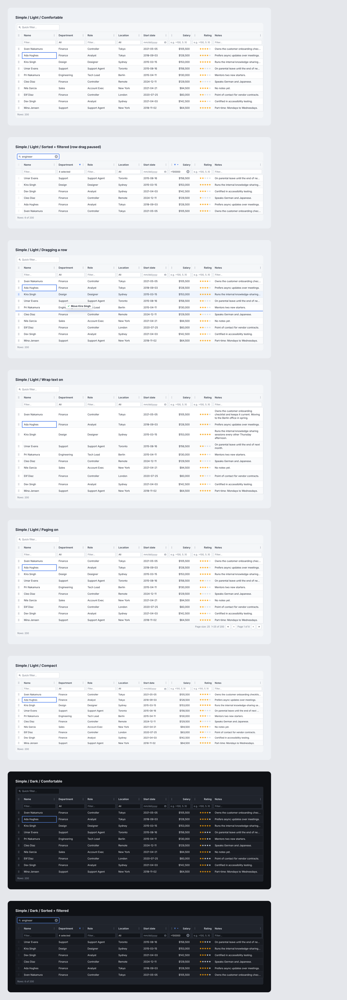
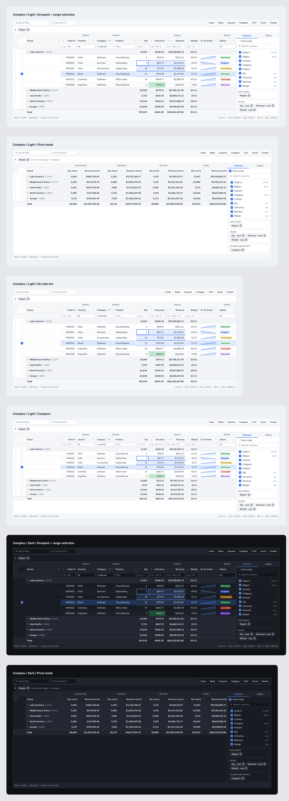
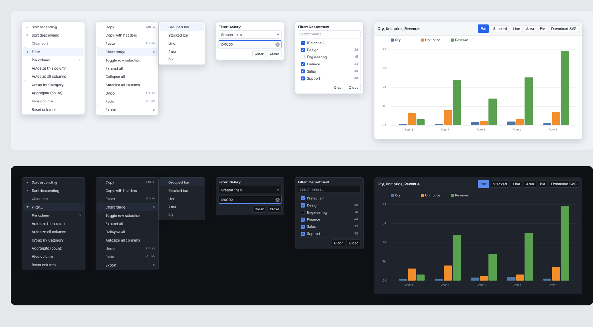
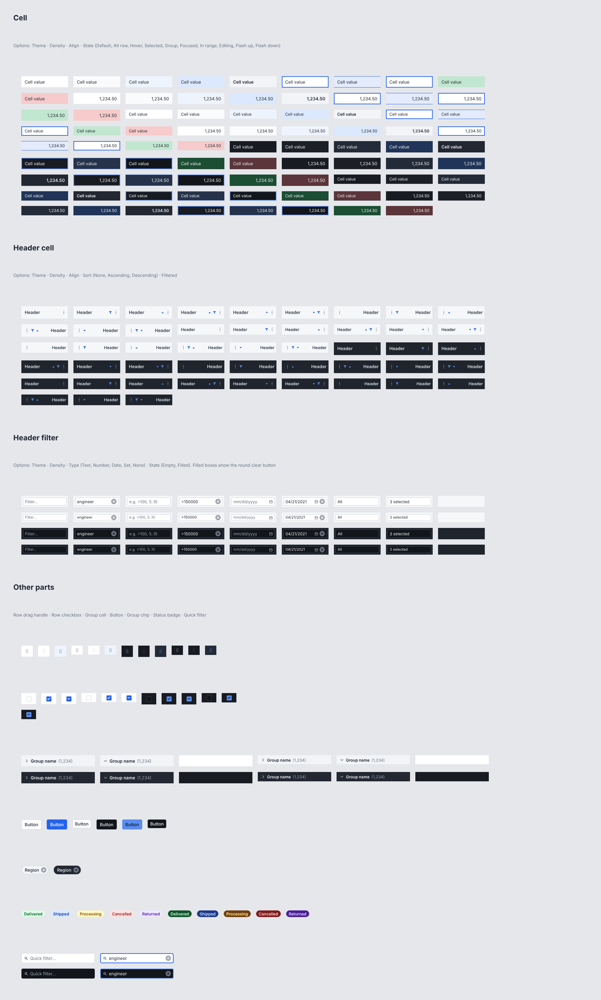

# Lattice Grid: Figma design kit

This folder holds a small Figma plugin. Run it once and it **builds the whole Lattice Grid design file
for you**, with real Figma components and variant options. No account access or network is needed.

## How to run it (about 1 minute)

1. Download this `figma` folder (or clone the repo).
2. Open the **Figma desktop app**. Development plugins can't be imported in the browser version.
3. Create a new, empty **Design** file.
4. Menu → **Plugins → Development → Import plugin from manifest…** and pick `figma/manifest.json`.
5. Menu → **Plugins → Development → Lattice Grid kit**. Building the six pages takes a few seconds.

Re-run it in another empty file whenever you want a fresh copy.

## What you get

| Page | Contents |
|---|---|
| **Cover** | Title and a summary of the options |
| **Tokens** | Light and dark colour tokens (backgrounds, text, borders, accent, range, flash) and type styles |
| **Components** | Components with variant properties (see below) |
| **Simple grid** | Default · Sorted + filtered (row drag paused) · Dragging a row · Wrap text on · Paging on · Compact · Dark · Dark sorted + filtered |
| **Complex grid** | Grouped + range selection (with side bar) · Pivot mode · No side bar · Compact · Dark · Dark pivot |
| **Overlays** | Column menu · Context menu with "Chart range" submenu · Number filter popup · Set (checkbox) filter popup · Chart dialog, each in light and dark |

### Component options

Pick any instance and change these in Figma's right-hand panel:

| Component | Options |
|---|---|
| Cell | Theme (Light, Dark) · Density (Comfortable, Compact) · Align (Left, Right) · State (Default, Alt row, Hover, Selected, Group, Focused, In range, Editing, Flash up, Flash down) |
| Header cell | Theme · Density · Align · Sort (None, Ascending, Descending) · Filtered (No, Yes) |
| Header filter | Theme · Density · Type (Text, Number, Date, Set, None) · State (Empty, Filled with the round clear button) |
| Row drag handle | Theme · Density · State (Enabled, Disabled, Dragging) |
| Row checkbox | Theme · Density · Checked (Off, On, Mixed) |
| Group cell | Theme · Density · Expanded (No, Yes, Leaf) |
| Button | Theme · Kind (Default, Primary, Small) |
| Group chip, Status badge, Quick filter | Theme, plus Status (Delivered, Shipped, Processing, Cancelled, Returned) or State (Empty, Filled) |

Text inside instances (cell values, header labels, group names) is editable as normal overrides. The grid
screens are built from these instances, so changing a component updates every screen.

## Previews

These show roughly what the plugin draws:

## Notes

- Uses the Inter font, which Figma includes.
- The colours match `lattice-grid.css`. If you change the CSS theme, update `THEMES` at the top of `code.js`.
